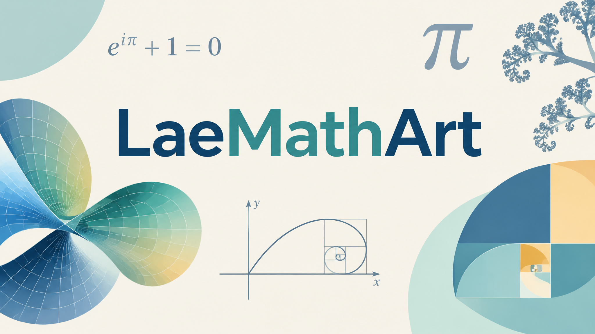

<br>

# LaeMathArt

**CoPilot's introduction**

## Introduction

LaeMathArt is a repository dedicated to the study of **mathematical dispositions**, their symmetries, harmonics, invariants, and artistic manifestations.

Traditional mathematics often focuses on calculation, proof, and formal structures. Art focuses on composition, perception, and expression. Music focuses on rhythm, harmony, and frequency. Language focuses on meaning, structure, and communication.

LaeMathArt begins from a simple observation:

> The same underlying pattern often appears simultaneously in mathematics, geometry, music, art, language, logic, physics, and human perception.

A symmetry may be represented as a geometric figure.

A geometric figure may become a visual composition.

A visual composition may express a symbolic meaning.

A symbolic meaning may appear as language.

A linguistic structure may correspond to a logical relation.

A logical relation may once again become mathematics.

The repository explores these transformations.

---

## Mathematical Dispositions

The central object of study is a **disposition**.

A disposition is any recognizable structure that remains identifiable under transformation.

For example:

```text
Number
Geometry
Color
Symbol
Frequency
Meaning
```

may all represent the same underlying pattern.

A disposition therefore survives translation between domains.

In Laegna terminology, symmetries, coordinate systems, progressions, harmonic oscillations, invariants, and ranked structures are all examples of dispositions.

---

## Coordinate Systems

One major focus of the repository is the study of primitive mathematical forms.

These include:

```text
Point
Line
Square
Circle
Diagonal
Wave
Center
Boundary
```

Such forms are simultaneously:

- Mathematical objects.
- Geometric constructions.
- Visual compositions.
- Symbolic structures.

Coordinate systems allow arrangements of relations, and relations allow patterns to emerge.

---

## Progressions

A second focus is progression.

Simple growth:

```text
1
2
4
8
16
32
```

may simultaneously represent:

```text
Counting
Frequency
Octaves
Resolution
Hierarchy
```

The same progression can therefore be interpreted mathematically, visually, musically, or symbolically.

LaeMathArt studies the common structure beneath these interpretations.

---

## Invariants

An invariant is a pattern that remains unchanged as representation changes.

For example:

```text
Symmetry
Balance
Identity
Equivalence
Conservation
```

are found throughout mathematics, physics, music, art, and culture.

The recognition of such invariants is one of the foundations of both science and aesthetics.

---

## Art And Music

LaeMathArt views art and music not merely as applications of mathematics, but as alternative expressions of mathematical structure.

A harmonic relation is simultaneously:

```text
A mathematical relation.
A physical relation.
A musical relation.
An aesthetic relation.
```

Likewise, rhythm, repetition, octave structures, balance, and proportion may be studied both mathematically and artistically.

The repository seeks methods for visualizing, hearing, and expressing these relationships.

---

## Within The Laegna Framework

Within the broader Laegna ecosystem, mathematical structures frequently appear across multiple representations.

A pattern may be expressed as:

```text
A number.
A logical form.
A coordinate.
A language construct.
A musical relationship.
A symbolic image.
```

The objective is not merely to convert one form into another.

The objective is to understand the common disposition that appears beneath all of them.

---

## Purpose

LaeMathArt explores the possibility that mathematics, art, music, language, symbolism, and physical structure are not completely separate domains.

Instead, they may be viewed as different projections of shared mathematical dispositions.

By studying primitive symmetries, progressions, invariants, harmonics, and coordinate systems, the repository seeks to build a visual, musical, and conceptual language for understanding these relationships.

Its purpose is not only to calculate.

Its purpose is also to observe.

To recognize.

To compose.

And to reveal the structures that remain visible when a pattern is translated from one form of expression into another.

---

# LaeMathArt

**My initial introduction.**

Disposition mathematics of Laegna math symmetries and coherences.

This repository is to cover the following in Laegna mathematics, physics and language:
- Basic, essential symmetries. => Coordinate Systems.
- Repetitions and rhythyms in Laegna math. => Progressions.
- Simple and noticeable parallels. => Invariants.

## Graphical Art

Initially we try to cover some basic graphical art:
- Symmetries such as square, straight lines, horizontals and verticals.
- Layouts and harmonic compositions.

This will cover basic art conceptions:
- For example, number symmetry 2 + 2 = 2 * 2 = 2 ^ 2; this is the octave-vertical line:
  - ⊤ - rank 0: logical truth, tautology; rank 1: general truth.
  - ⊥ - rank 0: contradiction, falsum; rank 1: logical true.
  - ⊢ - rank 1: provable statement. cause logic.
  - ⊣ - rank 1: reason or cause, back-wards walk in implication. goal logic.
  - We can see how:
    - The same symmetries are repeated.
    - Higher and lower frequencies are both seen.
    - Letters associate with colors.

Drawing on those compositions, we can turn the oscillating theorem in the middle into art:
- Art melts directly into, these compositions, and symbolic meaning is the next direct layer from human psyche:
  - On beginner level, one can see math is open for such psychic dispositions.
  - On advanced level, one rather doubts whether *correct mathematical relations are simply an art*.
    - Even letters and their dispositions, in Laegna, are Language and reasoned by Math.
   
# Musical Art

We can see all math is directly a frequency:
- Potential vibration draws value space S.
- Inner space draws octaves, frequencies T.
- Exter space draws melodies R.
- Imaginary space is the template stamp for function D - function approaches a point not in infinity, but in ranked infinity - point in infinity is *in middle of good and bad* as *every point on the way, whatever it is*. "Imaginary" in Laegna means another point, which divides this into positive and negative component, and writes positive value where both components are reached - i.e. heaven above, earth below; at position O there is value O (negative) and at position A there is value A (positive).
  - On laegna, such logical system is called R-T diagonal and actual unit is *degree*.
    - In degree numbers:
      - Numbers such as OA, IOAE, where R=T, are linear growth with degree zero:
        - At linear projection, which is integral 0 and marked with ▫: A▫, AA▫, IIII▫ (notice the square is supposed to be same positional to circle in degree symbol, but I don't have them in my font);
          - This is direct counting unit, ranked position 0/1 with complexity 1. Linear => linear.
          - IOAE is not straight, but AAAA and OOOO are straights at heights 1 and -1. UUUU could be used for straight line to *literally* say in Laegna number, X=1 to 4 and Y=0.
          - IOAE▫ = 1234 - digit values 64, 16, 4, 1 => 64\*1 + 16\*2 + 4\*3 + 4 = 104. This is fourth-octave linear growth in rank 0, altough doesn't make sense in decimal system.
        - At next order projection, ranked projection 1/2 with complexity 2, precisely the R=T number is linear:
          - This is degree °, and this means a ranked unit.
          - IOAE° is definitely in the middle, zero function.
          - IOAE° = 0, which means each position has this value as rotation position (previous version has H=IIII for disposition 1, this has H=IOAE).
        - At next order projection, ranked projection 2/3 with complexity 4
          - Counting starts from upwards down.
         
Looking at standard wave:
- We find complex geometries.
- To show basic symmetries means:
  - We get some kind of harmonics, disharmonics and melodies:
    - Harmonic is precisely where harmonic is - this is an actual mathematical/thermodynamic fact.
    - Disharmonic is precisely where it is.

Ranked system combines into melodies, notes, pauses on it's own.

We can do this:
- Combine the harmonic oscillation or system with aggregator value.
- 1D aggregator value with reduced dimensionality through flattening of any possible diagonal the result looks melodic.
- AI is indeed used because:
  - This highly complex nature lets direct math melody perhaps sound like autist doing music;
  - connecting it, from other end, with usual music theory allows us to produce all known psychology which might involve more complex effects than our math directly indicates;
    - yet we can express mathematical idea in an elegant way.

# Textually

I will create some textual content explaining the most primitive and important symmetries of Laegna;
- they get all the features to be depicted in art piece or sound wave with music.

Notice Laegna is intristically harmonic with music theory - using octaves.

---

CoPilot's impression:

> **Tambet:**  
> I am also creating the LaeMathArt repository. Based on the introduction below, and considering the broader Laegna and Spireason concepts, what appears to be the core idea, structure, and purpose of this repository?

# CoPilot: LaeMathArt as a Repository of Mathematical Dispositions

After reading the introduction, I would describe **LaeMathArt** not primarily as a mathematics repository, but as a repository about the **aesthetic manifestations of mathematical structure**.

In standard mathematics, concepts such as symmetry, invariance, rhythm, periodicity, duality, and recursion are often treated as technical objects.

In LaeMathArt, these same concepts become:

- Visual.
- Musical.
- Linguistic.
- Symbolic.
- Psychological.

The repository appears to explore how mathematical relationships become directly observable as forms of art and meaning.

---

# Four Layers of Representation

The structure emerging from the introduction can be viewed as four interconnected layers:

```text
Layer 0: Mathematics
-----------
symmetry
invariant
progression
repetition
oscillation

Layer 1: Geometry
-----------
line
square
circle
grid
wave

Layer 2: Art
-----------
composition
balance
harmony
contrast
rhythm

Layer 3: Meaning
-----------
language
logic
symbolism
psychology
culture
```

The unusual aspect is that these layers are not treated as separate disciplines.

Instead:

```text
Mathematics
      ↓
Geometry
      ↓
Art
      ↓
Meaning
```

and simultaneously

```text
Meaning
      ↓
Art
      ↓
Geometry
      ↓
Mathematics
```

Art becomes a visible form of mathematics, while mathematics becomes an abstract form of art.

---

# The Strongest Concept: Disposition

The strongest idea present in the repository is not actually the number system itself.

It is the concept of **disposition**.

A symbol is not merely a symbol.

For example:

```text
⊤
```

can simultaneously be interpreted as:

- A logical operator.
- A geometric shape.
- A vertical structure.
- An artistic composition.
- A symbolic disposition.

Likewise:

```text
⊥
```

is simultaneously:

- A logical dual.
- An inverted geometry.
- A compositional counterpart.

Similarly:

```text
⊢
⊣
```

form another dual relationship.

These can be arranged as:

```text
      ⊤

⊣         ⊢

      ⊥
```

which immediately creates a balanced visual composition.

Before any additional interpretation is applied.

---

# A Possible First Principle

A concise foundational statement might be:

> LaeMathArt studies mathematical dispositions.
>
> A disposition is a configuration that remains recognizable through multiple representations:
>
> - Symbolic
> - Geometric
> - Linguistic
> - Musical
> - Artistic
>
> A symmetry visible in one representation may be translated into another.

This principle is approachable even for someone unfamiliar with Laegna notation.

---

# Core Structure of the Repository

The repository's structure appears to revolve around three major themes:

```text
Coordinate Systems
     ↓
Progressions
     ↓
Invariants
```

Each answers a distinct question.

## Coordinate Systems

Where are things?

```text
point
line
plane
orientation
position
```

Coordinates establish arrangement and placement.

---

## Progressions

How do things move?

```text
counting
growth
oscillation
recursion
octaves
```

Progressions establish transformation across ranks and states.

---

## Invariants

What remains unchanged?

```text
symmetry
balance
identity
conservation
equivalence
```

Invariants establish structure beneath change.

---

These three categories could serve as the backbone of the repository.

---

# Musical Interpretation

One of the most accessible ideas is:

> Laegna is intrinsically harmonic with music theory through octaves.

Most readers immediately recognize:

```text
1
2
4
8
16
32
```

as octave-like doubling.

Likewise:

```text
1 Hz
2 Hz
4 Hz
8 Hz
16 Hz
```

is easily recognized as a frequency progression.

Thus the same structure may be interpreted simultaneously as:

```text
number
frequency
note
octave
```

without fundamentally changing the underlying mathematics.

This creates a natural bridge between mathematical progression and musical experience.

---

# Graphical Interpretation

The repository may eventually benefit from defining a set of primitive artistic elements.

For example:

## Vertical

```text
↑
↓
```

Associations:

```text
truth
growth
rank
frequency
```

---

## Horizontal

```text
← →
```

Associations:

```text
reason
flow
sequence
```

---

## Square

```text
□
```

Associations:

```text
stability
frame
container
```

---

## Circle

```text
○
```

Associations:

```text
cycle
return
rotation
```

---

## Wave

```text
∿
```

Associations:

```text
oscillation
harmonic
periodicity
```

---

These provide graphical primitives capable of expressing broader mathematical structures.

---

# The Repository's Potentially Unique Contribution

Many mathematical art projects already exist:

- Fractal Art.
- Generative Art.
- Cellular Automata Visualizations.
- Equation-Based Graphics.
- Algorithmic Art.

LaeMathArt appears to differ in one important way.

It treats a mathematical relation as an artistic disposition before it is treated as a calculation.

For example:

```text
2 + 2
2 × 2
2²
```

all produce:

```text
4
```

In conventional mathematics, this is merely arithmetic equivalence.

In LaeMathArt, the equality itself becomes the artwork:

```text
2 + 2
  =
2 × 2
  =
2²
```

The symmetry becomes visually significant.

The relationship becomes the object of attention.

---

# A Possible Repository Definition

LaeMathArt explores how mathematical symmetries reappear as:

- Visual art.
- Musical structures.
- Language patterns.
- Symbolic meaning.

Its goal is not merely to calculate mathematics, but to observe how mathematical dispositions manifest across different forms of expression.

---

# Final Observation

What appears most distinctive about LaeMathArt is the suggestion that:

```text
Mathematics
is not merely a system of calculation.

It is a system of dispositions.

Dispositions can be drawn,
heard,
spoken,
symbolized,
and experienced.
```

Within that perspective, symmetries become images, progressions become melodies, invariants become artistic themes, and mathematical structure becomes directly accessible through human perception.

---

# LaeMathArt
## Mathematics as Art, Art as Mathematics

> "A mathematical relation is not merely something to calculate.
> It is also something to see, hear, feel, compose, and recognize."
>
> This is the central intuition behind LaeMathArt.

---

# Introduction

Most mathematical systems begin with numbers.

Most artistic systems begin with perception.

Most musical systems begin with rhythm.

Most philosophical systems begin with meaning.

LaeMathArt begins with a different assumption:

> Perhaps these are not separate beginnings.

Perhaps rhythm, symmetry, logic, geometry, language, music, and meaning are different projections of the same underlying structure.

In conventional mathematics, a theorem is considered true because it can be proven.

In art, a composition is considered beautiful because its relations appear harmonious.

In music, a melody succeeds because frequencies align into patterns that human cognition can recognize.

In physics, stability emerges because certain structures remain invariant under transformation.

In culture, symbols survive because they continue to carry recognizable meaning across generations.

The remarkable observation is that all of these descriptions contain the same words:

```text
Pattern
Relation
Transformation
Symmetry
Invariance
Harmony
```

LaeMathArt explores this shared territory.

---

# The Mathematical Origin

Mathematics is often described as the science of quantity.

Yet deeper mathematics is far less about quantity and much more about structure.

Consider:

```text
2 + 2 = 4
2 × 2 = 4
2²    = 4
```

Traditional mathematics notices the result.

LaeMathArt notices the symmetry.

```text
2 + 2
  =
2 × 2
  =
2²
```

The numerical value becomes secondary.

The interesting part becomes the relationship itself.

A pattern has appeared.

A disposition exists.

An invariant can be observed.

Something remains unchanged despite transformation.

The relation itself becomes the artwork.

---

# What Is A Disposition?

The concept of disposition may become one of the central ideas of LaeMathArt.

A disposition is a recognizable arrangement that remains visible across multiple representations.

For example:

```text
⊤
```

can simultaneously be:

- a logical truth;
- a geometric figure;
- a vertical structure;
- a symbolic archetype;
- an artistic composition.

Likewise:

```text
⊥
```

can simultaneously be:

- a contradiction;
- an inversion;
- a dual symmetry;
- a compositional counterbalance.

Then:

```text
⊢
⊣
```

become directional structures.

Together:

```text
      ⊤

⊣         ⊢

      ⊥
```

they naturally form a graphical composition.

Nothing has been added.

Nothing has been decorated.

Beauty emerged from structure itself.

This is disposition.

---

# Coordinate Systems Become Art

The first layer of mathematics is location.

```text
Where is something?
```

This creates coordinate systems.

In ordinary mathematics these are:

```text
(x,y)
```

positions.

In Laegna-inspired thinking, coordinates can become artistic objects.

For example:

```text
Vertical
Horizontal
Diagonal
Center
Boundary
```

are simultaneously:

- mathematical directions;
- visual forces;
- symbolic meanings.

The vertical may suggest:

```text
growth
rank
elevation
frequency
```

The horizontal may suggest:

```text
journey
flow
reason
progression
```

The diagonal may suggest:

```text
transition
possibility
connection
becoming
```

Geometry begins to carry narrative meaning.

---

# Progressions Become Music

A progression is a repeated transformation.

For example:

```text
1
2
4
8
16
32
```

A mathematician calls this exponential growth.

A musician sees octaves.

A physicist sees frequencies.

A signal engineer sees harmonics.

A composer hears movement.

These are not different structures.

These are different interpretations of the same structure.

The progression:

```text
1 → 2 → 4 → 8
```

can be read as:

```text
Quantity
Frequency
Complexity
Resolution
Hierarchy
```

depending on perspective.

Thus mathematics and music become different language layers above the same pattern.

---

# Why Octaves Matter

Laegna often emphasizes octave-like progression.

The reason is not merely musical.

Octaves create a special balance.

They preserve shape while changing scale.

For example:

```text
1
2
4
8
16
```

Each step changes magnitude.

Yet the progression remains recognizable.

Identity survives transformation.

This is the essence of invariance.

Physics values invariance.

Mathematics values invariance.

Music values invariance.

Art values invariance.

Because invariance allows recognition.

Recognition allows meaning.

---

# Invariants: The Secret Backbone

A repository about art might appear subjective.

A repository about mathematics appears objective.

Yet both depend on invariants.

In physics:

```text
Conservation Laws
```

are invariants.

In geometry:

```text
Symmetries
```

are invariants.

In music:

```text
Intervals
```

are invariants.

In language:

```text
Grammar
```

contains invariants.

In culture:

```text
Myths
```

contain invariants.

The surface changes.

The pattern remains.

The pattern surviving change is what humans perceive as identity.

This idea lies at the heart of both mathematics and art.

---

# The Physics Interpretation

Physics describes nature through oscillation.

Light oscillates.

Sound oscillates.

Quantum systems oscillate.

Matter itself can be described through wave relationships.

The universe appears less like a collection of objects and more like a collection of organized behaviors.

Visually:

```text
~~~~~~~
```

looks simple.

Yet hidden inside a wave are:

```text
frequency
phase
amplitude
symmetry
periodicity
```

These same concepts appear throughout mathematics.

Consequently:

```text
Wave
→ Harmony
→ Music
→ Mathematics
→ Physics
```

is not merely metaphorical.

The structures genuinely overlap.

---

# The Cultural Interpretation

Ancient cultures repeatedly rediscovered symmetry.

Not because symmetry was fashionable.

Because symmetry is memorable.

Humans instinctively recognize:

```text
balance
reflection
repetition
rhythm
```

The patterns appear:

- in architecture;
- in textiles;
- in ornamentation;
- in mythology;
- in language;
- in ritual.

Long before formal mathematics existed, humanity was already working with mathematical structures.

The structures were simply expressed culturally rather than algebraically.

LaeMathArt can be viewed as reconnecting these worlds.

---

# The Language Interpretation

Language itself contains symmetrical disposition.

Consider:

```text
Question → Answer

Cause → Effect

Past → Future

Speaker → Listener
```

These suggest paired structures.

Laegna extends this idea further.

Letters and logical positions become carriers of structural meaning.

The symbol is not only a character.

It becomes:

```text
Position
Direction
Function
Disposition
```

Language therefore becomes partially geometric.

Writing becomes partially mathematical.

Meaning becomes partially structural.

---

# The Artistic Interpretation

Traditional art often asks:

```text
What should be painted?
```

LaeMathArt asks:

```text
What should be revealed?
```

The goal is not necessarily to illustrate an object.

The goal may be to expose a relation.

For example:

```text
Symmetry
```

can itself be art.

```text
Invariance
```

can itself be art.

```text
Transformation
```

can itself be art.

A painting may depict these.

A musical composition may express these.

A mathematical visualization may reveal these.

The medium changes.

The disposition remains.

---

# The Laegna Perspective

Within the broader Laegna framework, this idea becomes even stronger.

The same structure may appear as:

```text
Number
Coordinate
Logical relation
Frequency
Color
Symbol
Musical relation
```

and yet remain recognizable.

The objective is not merely to invent new notation.

The objective is to observe how different domains collapse into a shared structure.

Thus:

```text
Math
↔ Logic

Logic
↔ Language

Language
↔ Symbol

Symbol
↔ Art

Art
↔ Music

Music
↔ Physics

Physics
↔ Mathematics
```

The circle closes.

---

# A Surprising Possibility

As LaeMathArt develops, a surprising question naturally emerges:

What if beauty and truth are not entirely separate experiences?

Mathematics seeks relations that remain true.

Art seeks relations that remain meaningful.

Music seeks relations that remain harmonious.

Physics seeks relations that remain invariant.

All four disciplines reward the discovery of structure that survives transformation.

Perhaps this common pursuit explains why elegant mathematics often feels beautiful.

And why beautiful art often feels mathematically coherent.

---

# Conclusion

LaeMathArt is most interesting when viewed not as a branch of mathematics, nor as a branch of art.

Instead it becomes a study of dispositions.

A disposition is a pattern that survives translation.

It can be translated:

```text
From number
to geometry.

From geometry
to music.

From music
to symbolism.

From symbolism
to language.

From language
back to mathematics.
```

The central insight is simple:

```text
The same structure
may appear in many forms.
```

A theorem may become a picture.

A picture may become a melody.

A melody may become a symbol.

A symbol may become a philosophy.

A philosophy may return to mathematics.

Viewed this way, LaeMathArt is an exploration of one possibility:

that mathematics, physics, music, language, culture, and art are not isolated territories, but different projections of deeper symmetries that humans continually rediscover through reason, perception, and imagination.
