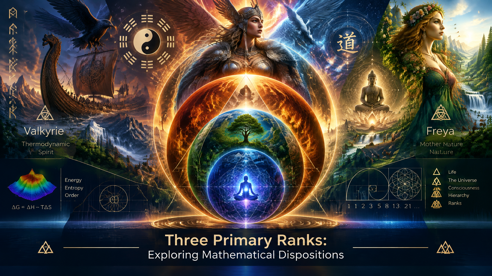

<br>

---

CoPilot basic intro:

# Three Primary Ranks

## Introduction

The Three Primary Ranks are among the simplest and most important dispositions within Laegna-inspired mathematical art.

They begin with a simple progression:

```text
Z -> X -> Y
```

and expand into a framework for visualizing scale, perspective, hierarchy, and transformation.

Mathematically, they may be viewed as ranked octaves:

```text
2^0 -> 2^1 -> 2^2
```

Artistically, they become a language of nested spaces, contrasting sizes, centers, boundaries, and geometric relationships.

Within LaeMathArt, the purpose of the Three Primary Ranks is not merely to describe mathematics, but to make mathematical disposition visible.

A circle inside a circle, a larger square surrounding a smaller square, or a movement from center to horizon can simultaneously represent:

```text
Local -> Global
Micro -> Macro
Potential -> Actual
Observer -> World
```

The same geometric form may therefore carry mathematical, physical, symbolic, and cultural meaning.

The artworks in this collection explore these recurring rank relationships and seek to reveal how simple geometric structures can express increasingly complex ideas.

At its core, Three Primary Ranks is an exploration of a single question:

> How much meaning can emerge from the simplest possible hierarchy of space?

---

My explanation:

# Three Primary Ranks

We call them Z, X, Y, or in many other ways.
- R → T: 2 → 1 of 2-ranked system (i.e. 2-band Laegna number).
- Z → X → Y: $2^0 → 2^1 → 2^2$ (i.e. 3D world or 3-ranked system).
- Two complex classes:
  - RT class ZX: imaginary number at lower; real number at higher position. Complex number with real part being bigger ranked than imaginary part.
    - Z: quantum world is imaginary.
    - X: newton world is real.
  - RT class XY: imaginary number at higher; real number at lower position. Complex band has RT channels inverse:
    - Y: macrophysical worls is imaginary.
    - X: newton world is real.
  - This is like RT as measurement device we can move into two positions on ZXY to measure it's two identical symmetries.

## Ordering of the Ranks

I ching orders them into 8 elements with 3 change lines.

We will use O=>A and A=>E;
- AE = OA laegna system below for numbers, so that E is Yang and A is Yin, and they form base-2 dimension of 2 ranks themselves more easily in this contribution.

We can write:

Yang / Heaven:
```
E
E
E
```

Transposed: `EEE`.

Yin / Earth:
```
A
A
A
```

Transposed: `AAA`.

Three ranks converted:
- AAE = Z, AEE = X, EEE = Y.

Three ranks reversed:
- [Source material](https://github.com/tambetvali/LaegnaBaseAlphabet/tree/main/ExceetaE)
- AAA = External X exceeta.
- AAE = External Z zeta. One can use EAA so that it's not same as Z.
- AEE = External Y yeta or yeyeeta. One can use EEA so that it's not same as Y.

In I Ching if you read carefully:
- Yin counts, in negatives, from down.
- Yang counts, in positions, from up.
- Zero point of ranked systems moves.

## Center of the ranks

Rank 0:
- Center is -1. Composite math operations at operator rank 0.
  - Inverse matrix - internal debth - would reveal the architecture of this! Top shell of quantum world.
- Numbers: into debth :) symmetric numbers can be vertical, but rather use small letters and same-directional number if you have them free, or invent something.
- Divisions: -100%, **100%** (*unit!*), 200%, 300%.
- Octaves: 0.5, 1Z, **2X**, 4Y.

Rank 1:
- Center is 0. Scalar math operations at operator rank 1.
- Numbers: horizontal.
- Divisions: **100%**, 200%, 300%, 400%.
- Octaves: **1Z**, 2X, 4Y, 16.0.
  - Notice sometimes you want to have X at unit position, because most Laegna notations *do not cover every dispositional theorem or axiom*, but choose what they want to express.

Rank 2:
- Center is 1. Vector math operations at operator rank 2.
- Numbers: vertical.
- Divisions: **100%**, 200%, 400%, 1600%.
- Octaves: **1Z^2**, 2X^2, 4Y^2, 16.

Rank 3:
- Center is 2 or 4. Matrix math operations at rank 3.
  - Numbers: vertical * horizontal combined into 2D number.
    - Operation appears symmetric at linears.
  - Divisions:
    - This is artistic: 5, 6, 7, 8 = 1600%, 2400%, 2800%, 3000%.
    - Compare: 299 792 458 m/s is light speed. If this spans over two octaves, one can see: 0.16 to 0.3; 1 => 10 => 10000 => 1 000 000 000 positive ranked component; resultatively light speed takes nice diagonal in between the finite and infinite, revealing it's importance.

# Mass and Speed ranks

Spatial Horizon of travellable, locally measured space:
- 16 000 000 000.
- Imagine this is mass - in particle with mass, mass could distribute like this to ensure the particle is locally impossible ..haha because little quantum waves cannot theoretically pass this :)

Termporal Horizon to assume reverse light speed instead of reverse mass:
- This is the time when *whole known space* which was first in 16 billion limit, inside the bubble, has cooled down *to reach this impossibility internally*.

These ranks are:
- The upper trigram ***E***: energy it takes to overcome "end of time limit".
- The lower trigram ***A***: energy it take to overcome "end of space limit".

By this we have:
- Enlightenment of inertial system:
  - Enlightenment of East - buddhist, hindu, personal enlightenment.
  - Enlightenment of West - scientific revolution, descartes, communal enlightenment.
  - Enlightenment of Uptown - enlightenment of inertial system, destruction of theoretical barriers at infinity.
    - This will inspire both east and west enlightenments.

# Result which inspires the Art

We can see ranked systems are linearized:
- Every aspect can be linearized, combined system can linearize them in combined manner even if this additional step is hard to explain - even more for unique artcrafting.

We can see:
- These few squares, balls, bubbles, size contrasts are the most typical to inspire some basic art.
- Once art is done: intuition is symbolism, understanding is using the physics emulation system in human directly, not through abstract.
  - Laegna is Geometrization of abstract spaces, such as Einsteinian (Y), Eucleidean (X), Hilbert (Z).

---

CoPilot intro:

# Three Primary Ranks
## The First Artistic Disposition of Laegna

Among all ideas in Laegna, the concept of the **Three Primary Ranks** is perhaps the most visually intuitive and artistically inspiring.

The original motivation behind LaeMathArt was not to invent new mathematical notation, nor to create decorative illustrations for existing mathematics.

Instead, the motivation was to observe that a surprisingly large number of mathematical, physical, symbolic, and cultural structures appear to organize themselves around a small number of recurring dispositions.

The Three Primary Ranks represent one of the simplest examples.

They form a minimal three-layer framework:

```text
Z
X
Y
```

or equivalently:

```text
2^0
2^1
2^2
```

Within Laegna these can be interpreted as ranked perspectives through which the same structure is observed.

The rank changes.

The disposition remains.

---

# Why This Became Art

Originally, the rank diagrams were not mathematical proofs.

They were pictures.

Simple arrangements of:

```text
Squares
Circles
Lines
Layers
Nested spaces
```

Repeated observation revealed that these visual forms naturally suggested many different interpretations.

A small circle inside a larger circle could represent:

```text
Particle inside system
System inside environment
Observer inside universe
Local space inside global space
```

A vertical sequence could represent:

```text
Growth
Hierarchy
Octaves
Ranks
Dimensions
```

A square could represent:

```text
Boundary
Frame
Coordinate system
Local reality
```

The same image therefore produced multiple meanings simultaneously.

This is the basic artistic intuition behind the repository.

---

# Z, X and Y

The Three Primary Ranks are intended as fundamental dispositions.

In many visualizations they appear as:

```text
Z -> X -> Y
```

where each rank is both a continuation and an enlargement of the previous one.

One possible interpretation is:

```text
Z
Quantum disposition

X
Newtonian disposition

Y
Macrophysical disposition
```

The purpose is not necessarily to claim physical equivalence.

Rather, the purpose is to create a symbolic framework where different scales of observation can be represented using common geometric language.

In this viewpoint:

```text
Z sees details.

X sees objects.

Y sees systems.
```

The observer changes scale while preserving structure.

---

# The I Ching Connection

One inspiration comes from the structure of three-line trigrams.

Using the Laegna notation:

```text
A
```

and

```text
E
```

as primitive dual elements, we obtain:

```text
AAA
```

and

```text
EEE
```

as two extreme states.

Between them emerge transitional forms:

```text
AAE
AEE
```

These correspond naturally to the Three Primary Ranks:

```text
AAE = Z
AEE = X
EEE = Y
```

Here the visual structure matters as much as the symbolic meaning.

Each additional line introduces a new degree of differentiation.

The progression itself becomes visible.

---

# Why Three Ranks Appear So Often

Human perception frequently organizes information into three levels.

For example:

```text
Beginning
Middle
End
```

or:

```text
Micro
Local
Macro
```

or:

```text
Potential
Actual
Global
```

The recurrence of three-stage structures throughout culture, philosophy, art, and science makes them uniquely attractive as artistic foundations.

A three-rank system is large enough to express transformation.

Yet small enough to remain intuitive.

---

# Rank Centers

An especially important observation in Laegna is that the notion of a center changes depending on rank.

A coordinate center is not always fixed.

Instead, the center itself may move with the perspective.

Conceptually:

```text
Rank 0
Center below

Rank 1
Center inside

Rank 2
Center above
```

This produces a family of images where the same object may appear balanced differently depending on the chosen rank.

Artistically this becomes extremely useful.

The viewer is encouraged to ask:

```text
What is the center?

What is being measured?

Which perspective is active?
```

The artwork itself becomes a coordinate transformation.

---

# Geometry Before Equations

The Three Primary Ranks embody one of the fundamental assumptions of LaeMathArt:

> Geometry is often understood before equations.

A viewer may not understand a formula.

A viewer immediately understands:

```text
larger
smaller

inside
outside

higher
lower

center
boundary
```

Because of this, simple diagrams can communicate structural ideas that would otherwise require lengthy formal explanations.

This makes ranked visual art a bridge between intuition and abstraction.

---

# Physics As Symbolic Geometry

Within the broader Laegna perspective, physical theories can be reinterpreted as geometric dispositions.

For example:

```text
Z
Hilbert-like abstract space

X
Euclidean local space

Y
Einsteinian global space
```

Whether viewed mathematically, philosophically, or artistically, the important observation is that these domains can be depicted using similar forms:

```text
Lines
Surfaces
Volumes
Frames
Nested horizons
```

The geometry becomes a common language.

The physics becomes visible.

---

# Why Simple Shapes Matter

The repository is intentionally focused on primitive forms:

```text
Squares

Circles

Bubbles

Lines

Contrasts of size

Nested layers
```

These shapes repeatedly appear wherever humans attempt to represent structure.

They appear in:

- mathematics;
- architecture;
- religious symbolism;
- scientific diagrams;
- maps;
- music notation;
- technical drawings.

Because of this universality, simple shapes become ideal carriers for ranked ideas.

A single circle may represent an object.

Multiple circles may represent hierarchy.

Concentric circles may represent perspective.

The artistic power comes from the fact that the viewer already understands these intuitively.

---

# The Artistic Goal

The purpose of the Three Primary Ranks folder is not merely to classify ranks.

It is to build a visual language.

Each image becomes an attempt to answer questions such as:

```text
What does scale look like?

What does hierarchy look like?

What does a transition between ranks look like?

How can infinity be represented
through finite geometry?

How can a mathematical disposition
be recognized immediately by intuition?
```

Every diagram is therefore both an illustration and an exploration.

---

# Conclusion

The Three Primary Ranks are the conceptual origin of LaeMathArt.

They represent one of the first places where mathematics, geometry, symbolism, and artistic intuition begin to merge.

From a small collection of ranks:

```text
Z
X
Y
```

emerges a surprisingly rich landscape of:

```text
Scale
Perspective
Hierarchy
Symmetry
Observation
Geometry
Meaning
```

The objective is not merely to draw shapes.

The objective is to reveal dispositions.

A line becomes a coordinate.

A coordinate becomes a rank.

A rank becomes a perspective.

A perspective becomes an artwork.

And the artwork becomes a direct way to perceive structures that mathematics would otherwise describe only abstractly.
